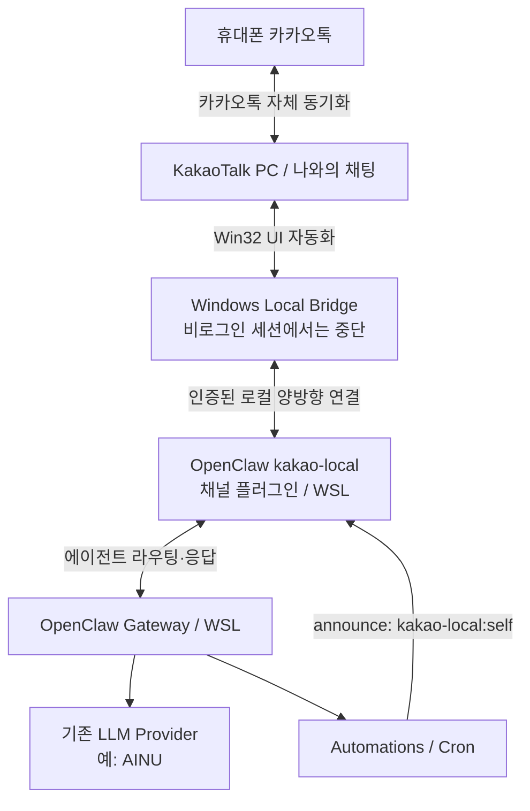

# OpenClaw × KakaoTalk Local Bridge — 구현 계획서

> **문서 상태:** 설계 초안 v0.1  
> **작성일:** 2026-10-13  
> **대상:** Windows 10/11, 카카오톡 PC, OpenClaw Windows Companion + WSL Gateway  
> **배포 목표:** 비전공자도 Windows 설치 프로그램 또는 승인형 설치 프롬프트로 설치  
> **구현 상태:** 설계 단계. 문서에 기재된 자동 응답·원샷 설치는 아직 구현·검증 완료된 기능이 아님.

---

## 0. Executive Summary

**채택안:** 사용자 PC에만 설치되는 Windows 카카오톡 브리지와 OpenClaw 채널 플러그인(`kakao-local`)을 결합한다. 카카오톡 **'나와의 채팅'** 에서 `!ai`로 질문하면 OpenClaw가 응답하고, OpenClaw Automations(Cron) 결과도 같은 채팅방에 전달한다.

- **필요 없음:** 공용 릴레이 서버, 개인 카카오톡 채널·챗봇 개설, 카카오 i 오픈빌더, Cloudflare Tunnel, ngrok, 별도 봇 계정.
- **필요함:** 실행 중이며 로그인된 Windows 카카오톡 PC, 켜져 있는 개인 PC, 설치·구성된 OpenClaw Gateway, 로컬 브리지 앱.
- **권장:** Windows 로그인 시 자동 시작, Windows 사용자의 로그인 세션에서 UI 자동화 수행. 다른 계정 또는 컴퓨터 사용자 대상 서비스로 확장하지 않음.
- **가장 큰 기술 위험:** 카카오톡 '나와의 채팅'에서 **새로운 입력의 안정적인 감지** 및 **자기 메시지 재처리 방지**. 이 부분이 동작하지 않으면 배포 단계로 가지 않는다.
- **가장 큰 제품 제약:** PC가 잠겨 있거나 잠든 상태의 **실시간 동작을 보장하기 어렵고**, 비공식 UI 제어에 따른 변경·오작동·카카오 이용약관 문제가 남는다.
- **원샷의 정의:** 사용자가 신뢰할 수 있는 설치 프로그램 실행 또는 외부 코드 실행 승인 **1회**, 기존 OpenClaw 선택, 카카오톡 로그인 확인, `나와의 채팅` 연결 테스트 정도만 직접 수행한다. 카카오톡 로그인·OS 보안 승인까지 무인으로 우회하지 않는다.

### 성공 기준 한 문장

> Windows 로그인 상태에서 휴대폰 카카오톡 '나와의 채팅'에 `!ai 안녕`을 보내면 PC의 OpenClaw가 **정확히 한 번** 응답하고, 등록한 단발성 알림이 정해진 시간에 같은 채팅방에 **정확히 한 번** 전송된다.

---

## 1. 목표, 범위, 비목표

### 1.1 사용자 스토리

| ID | 사용자 행동 | 기대 결과 | 우선순위 |
| --- | --- | --- | --- |
| US-01 | 모바일 '나와의 채팅'에 `!ai 오늘 일정 요약해줘` 전송 | OpenClaw 응답이 같은 채팅방에 도착 | P0 |
| US-02 | `!ai 10분 뒤 물 마시라고 알려줘` 전송 | OpenClaw 자동화 생성 후 예정 시각에 알림 도착 | P0 |
| US-03 | PC를 재시작하고 Windows에 로그인 | 사용자가 새 명령 없이 브리지·Gateway 재연결 | P1 |
| US-04 | 카카오톡 PC가 종료됨 | 원인 표시, 반복적인 전송 시도/오발송 방지 | P1 |
| US-05 | `!ai`가 아닌 개인 메모 입력 | 아무 반응 없음 | P0 |
| US-06 | 사용 중 연결을 일시 정지 | 트레이 메뉴 또는 GUI에서 감시·발송 중단 | P1 |
| US-07 | 앱 제거 | 자동 시작 해제, 로컬 데이터 삭제/보존 선택 | P1 |

### 1.2 MVP 지원

- Windows 10/11 + 카카오톡 PC 앱의 **본인 계정 '나와의 채팅' 1개**만 감시.
- `!ai` 접두사가 있는 텍스트 명령만 수신. 봇 메시지는 `[OpenClaw]`, 예약 알림은 `[OpenClaw 알림]`으로 시작.
- 기존 OpenClaw Gateway와 연결하여 **설정된 기본 에이전트**를 사용. AINU, GPT 또는 다른 모델의 설정을 변경하지 않음.
- 한 대화방에 대한 지속 세션(에이전트가 문맥 유지), 전송 결과 확인, 시간 초과/에러 표시.
- OpenClaw의 내장 Automations(Cron) 작업 **결과를** 같은 방에 배달. 작업 실행 및 전달 실패를 분리해 기록.
- 안전한 일시 정지/재개, 상태 확인, 로컬 전용 진단.

### 1.3 MVP에서 제외

- 일반 1:1 대화방/단체방·오픈채팅방 감시, 다중 카카오톡 사용자, 타인에게 대량 발송.
- 사진·음성·파일 처리, UI 외부의 카카오톡 개인 DB 접근, 비공식 네트워크 프로토콜 구현.
- PC가 종료되어 있어도 알림이 도착하는 상시 가동 보장.
- 윈도우 잠금 화면에서 완전 무인 동작 보장.
- OS 권한 승인·카카오톡 로그인 자동 우회, 기존 클라이언트 보안 설정 완화.

---

## 2. 기술 근거와 설계 결정

1. [`kronenz/kakaotalk-mcp`](https://github.com/kronenz/kakaotalk-mcp)는 Windows Win32를 활용해 **열린 채팅방 검색·읽기·텍스트 전송·모니터링**을 구현했다. 단, 창이 앞에 나타나는 현상, 클립보드 사용, 최소 폴링 간격 3초, UI 업데이트 의존성을 명시한다.
2. [OpenClaw Channel Plugin SDK](https://docs.openclaw.ai/plugins/sdk-channel-plugins)는 채널 메시지 수신을 에이전트 라우팅으로 연결하고 응답을 채널로 보내는 확장 지점을 제공한다. **해당 SDK는 실험적**이므로 버전별 호환성 검증이 필요하다.
3. [OpenClaw Automations](https://docs.openclaw.ai/automation/cron-jobs)와 [Delivery](https://docs.openclaw.ai/automation/cron-jobs/delivery)는 `announce`, `webhook`, `none` 전송을 제공한다. **권장 최종 구조는 `announce` + 자체 `kakao-local` 채널 플러그인**이다.
4. [Gateway OpenAI HTTP API](https://docs.openclaw.ai/gateway/openai-http-api)는 대안으로 사용할 수 있지만 `/v1/chat/completions`가 기본 비활성화이며 Gateway 운영자 수준 인증을 필요로 한다. **최종 배포에서는 이를 무분별하게 노출하지 않는다.**
5. 참고 구현의 코드·라이선스를 재사용할 경우 해당 저장소의 **MIT 라이선스 고지** 및 외부 패키지 버전 고정을 유지한다. 필요하면 브리지 기능만 직접 구현할 수 있다.

**핵심 선택:** `kakaotalk-mcp`를 사용자에게 직접 AI의 범용 도구로 노출하지 않는다. 대신 PC 카카오톡 UI의 입력/출력만 담당하는 **전용 Windows Adapter**로 감싼다. 이 방식이 기능을 제한하고 테스트하기 쉽다.

---

## 3. 전체 시스템 아키텍처



### 3.1 구성요소 책임

| 구성요소 | 실행 장소 | 역할 | 기술 후보 |
| --- | --- | --- | --- |
| Windows Local Bridge | 사용자 Windows 로그인 세션 | 채팅방 읽기/쓰기, 중복 제거, 로컬 상태 관리, GUI/트레이 | Python 3.11 + pywin32 + PySide6 (후보) |
| Kakao UI Adapter | Bridge 내부 | Win32 창 탐색, 읽기, 전송 결과 검증 | kakaotalk-mcp 기반 래퍼 또는 검증 후 자체 구현 |
| Event Router | Bridge 내부 | `!ai` 식별, 이벤트 ID, 인바운드 큐, 응답 루프 차단 | Python 표준 라이브러리 + SQLite |
| OpenClaw Channel Plugin | 기존 WSL Gateway | 인바운드 AI 실행, 채널 세션 매핑, Cron announce 출력 | TypeScript + `openclaw/plugin-sdk/channel-core` |
| Local Transport | Windows↔WSL | 오직 사용자 PC 내부에서만 양방향 연결 | Windows에서 시작하는 loopback WebSocket 후보 |
| Tray Setup/Diagnostics | Windows | 초기 설정, 카카오톡 로그인 확인, 상태 표시, 일시 정지 | Windows GUI |
| Package/Installer | GitHub Releases | 서명·버전 검증, 설치, 자동 시작, 삭제 | WiX/MSIX/Inno Setup (선정 예정) |

**주의:** WebSocket 또는 로컬 HTTP 리스너를 사용하더라도 이는 **사용자 PC 내부 통신용 리스너**이며 인터넷에 공개하는 별도 공용 릴레이 서버를 뜻하지 않는다.

### 3.2 Windows↔WSL 연결

1. `kakao-local` 채널 플러그인과 Windows Bridge 간 **내부 전송 계약**을 정의한다.
2. 우선 Windows Bridge가 WSL 쪽 loopback 리스너에 연결하는 패턴을 평가한다. Windows의 `127.0.0.1` → WSL 연결이 해당 OpenClaw Hub/WSL 구성에서 정상 동작하는지 먼저 검증한다.
3. **로컬 연결에도 랜덤 페어링 비밀값·버전 협상·단일 브리지 검증을 적용한다.** 운영자용 Gateway 토큰을 UI 자동화 코드 또는 로그에 직접 저장하지 않는다.
4. 연결 실패 시 재접속하며, 메시지 큐는 **유효 기간이 지난 작업을 무조건 재발송하지 않도록** 한다.
5. Windows↔WSL loopback이 환경마다 달라 작동하지 않으면 **대체 전송 경로를 먼저 검증**하고 설계를 고정한다. 연결 제약 해결을 위해 외부 공개 포트를 열지 않는다.

#### MVP 검증을 위한 임시 경로

전용 채널 플러그인 작성 이전에 **개발 전용 어댑터**로 `openclaw agent` CLI 호출을 사용하여 채팅 왕복을 검증할 수 있다. 이는 최초 PoC에만 사용하고, 배포용 기본 경로로 확정하지 않는다. Gateway HTTP Chat Completions를 대안으로 사용할 경우에도 기본 비활성화, 운영자 토큰 범위, 세션 라우팅과 로컬 바인딩을 명시적으로 검토해야 한다.

### 3.3 이벤트 계약(예시, 최종 API 아님)

```json
{
  "type": "inbound.message",
  "eventId": "local-stable-id-or-uuid",
  "roomId": "self",
  "observedAt": "2026-10-13T15:00:00+09:00",
  "text": "내일 오전 10시에 알림 설정해줘",
  "commandPrefix": "!ai"
}
```

```json
{
  "type": "outbound.message",
  "deliveryId": "job-or-response-id",
  "roomId": "self",
  "text": "[OpenClaw] 알림을 등록했어.",
  "expiresAt": "2026-10-13T15:05:00+09:00"
}
```

응답 텍스트의 실제 어투는 사용자의 에이전트 설정을 따른다. 위 JSON은 **브리지 메시지 계약의 예시**이며 OpenClaw의 공식 RPC 형식이라고 주장하지 않는다.

---

## 4. 핵심 구현 설계

### 4.1 카카오톡 읽기(최우선 PoC)

**입력 프로세스:** '나와의 채팅' 열기 → 기존 메시지 baseline 작성 → 일정 간격으로 마지막 대화 읽기 → 신규 메시지 분류 → `!ai`만 큐에 넣기.

- 처음 연결 시 과거 명령은 **전부 무시**하고 기준선만 저장한다.
- 채팅방은 UI의 정확한 제목/유형을 확인하여 **오인식 시 전송 중단**. 다른 방에는 전송하지 않는다.
- 최소 폴링 3초는 참고 구현의 제한이다. 기본 폴링은 **5초(초안)**, CPU/포커스 영향 테스트 후 적응형 폴링으로 조정한다.
- 읽기 시 포그라운드 전환이나 클립보드 사용 가능성을 사용자에게 고지한다. Windows 클립보드를 덮어쓰는 방식은 충돌·민감정보 노출 우려가 있으므로 안전하게 복구하거나 접근을 직렬화한다.
- 같은 시각·내용의 메시지가 두 번 입력되거나 PC 동기화가 지연되는 경우를 고려한다.
- **최우선 검증 대상:** 모바일에서 보낸 '나와의 채팅' 메시지가 Windows 클라이언트의 감시 대상에 새 메시지로 나타나는지, 잠긴 상태/최소화 상태/다른 앱 사용 중 감지 가능한지.

### 4.2 중복 처리 및 자기 응답 방지

1. 인바운드 입력은 `!ai `로 시작해야 한다. `[OpenClaw]`, `[OpenClaw 알림]`은 절대 에이전트 입력으로 처리하지 않는다.
2. `eventId`는 타임스탬프+방 식별자+내용+관찰 순서 등 **복합 식별**로 생성하고 SQLite에 처리 이력을 보관한다. 해시 1개만으로 메시지 고유성이 보장된다고 가정하지 않는다.
3. 최근 봇 발신 내용의 체크섬과 `deliveryId`를 저장해, UI에서 다시 관찰된 메시지를 전송 중복으로 인식한다.
4. 큐는 `observed → accepted → processing → delivered/failed` 상태를 사용한다. 재시도는 중복 발송 가능성을 고려해 제한한다.
5. 시간 경과 후 동일 명령을 사용자가 의도적으로 재입력할 수 있어야 하므로 장기적으로 **내용 자체만을 중복 키로 사용하지 않는다.**
6. 사용자 명령은 한번에 최대 1개, 대기 큐 5개(초안)로 제한해 과도한 API 호출을 막는다.

### 4.3 OpenClaw 대화 연동

- 개발 시 기본 에이전트는 `main` 사용, 변경 가능하게 설계한다.
- Channel Plugin SDK의 표준 **인바운드 메시지·에이전트 라우팅·아웃바운드 응답** 기능을 사용한다.
- `roomId=self`에 고정된 대화 세션을 연결해 문맥을 유지한다. 기존 웹채팅 세션과의 통합은 기본 지원 범위에 넣지 않는다.
- 에이전트별 기존 API 공급자·모델 ID·Thinking 설정·권한을 존중한다. 설치 프로그램이 기존 AINU 설정을 수정하지 않는다.
- GUI에는 `대기 중 / 답변 생성 중 / 전송 중 / 오류` 상태를 표시한다. 응답 중 PC 카카오톡이 종료되면 작업 결과의 중복 전송을 피한다.

### 4.4 정기 알림 통합

**권장 구현:** OpenClaw Automations에서 `announce`의 채널을 `kakao-local`로 지정하고 대상(`to`)은 고정된 `self`로 설정한다.

```text
사용자: !ai 매일 오전 8시에 오늘 일정 요약해줘
OpenClaw: 자동화 생성 → target: kakao-local:self
예약 시각: OpenClaw Cron 실행 → 최종 결과 → kakao-local 출력 → Windows Bridge → 나와의 채팅
```

- 채널이 온라인이면 알림을 즉시 배달하고 성공·실패 상태를 기록한다.
- 채널이 오프라인이면 결과의 중요도에 따라 로컬 큐(선택)를 보관하되, **상한과 만료시간**을 둔다. 과거 알림을 무조건 대량 재발송하지 않는다.
- Cron 작업이 실제 성공했는지와 카카오톡 전송이 성공했는지를 독립적으로 기록한다.
- **단순 개인 알림**에 한해 기존 OpenClaw의 관리 UI에서 생성/취소할 수 있게 한다. 모든 Cron 작업을 사전 승인 없이 카카오톡으로 전달하도록 하지 않는다.
- 대안으로 Cron `webhook` → 로컬 브리지 HTTP 서버가 있지만, [OpenClaw Webhook SSRF 정책](https://docs.openclaw.ai/automation/cron-jobs/delivery)은 기본적으로 loopback/private 대상 요청을 차단하므로, **기본 설계에 사용하지 않는다**. 특별히 허용할 경우 정확한 loopback 호스트만 허용해야 한다.

### 4.5 Windows 실행 형태

- Win32 UI 조작은 **로그인된 사용자 데스크톱 세션**에서 실행. Session 0 Windows Service만으로는 구현하지 않는다.
- Windows 시작 프로그램/작업 스케줄러의 **사용자 로그인 시 실행**을 사용한다.
- PC 잠금·절전·사용자 로그아웃을 감지하고 상태를 GUI에 표시한다. 잠금 해제를 우회하지 않는다.
- 트레이 메뉴: 상태, 테스트 발송, 일시 정지, 자동 시작, 로그 내보내기(민감정보 제거), 업데이트 확인, 제거.
- 브리지 오류가 반복되면 backoff 후 중단하고, 무한 루프로 카카오톡을 활성화하지 않는다.

---

## 5. 권장 기술 스택

| 영역 | 선택안 | 선택 이유 |
| --- | --- | --- |
| Windows Bridge | Python 3.11+ | 참고 MCP 코드 재사용 및 Win32 테스트가 쉬움 |
| 카카오 UI | `pywin32`, 필요 시 `psutil` | 창·프로세스 감지 및 사용자 세션 자동화 |
| 로컬 IPC | `websockets` 또는 동일 기능의 경량 라이브러리 | Windows ↔ WSL 양방향 큐/상태 |
| 로컬 DB | `sqlite3` | 이벤트 ID·배달 상태·설정 이력 |
| GUI | PySide6 또는 WinUI | 접근성·설정·상태 관찰성 확보. 출시 전 최종 선택 |
| OpenClaw Plugin | TypeScript + 공식 Plugin SDK | 표준 채널 라우팅, 세션 및 Automations 전달 |
| 배포 | 서명된 Windows 설치 프로그램 + GitHub Release | 비전공자에게 배포 용이, 버전 롤백 가능 |
| CI | GitHub Actions Windows/Linux 테스트 | 기능 회귀·버전별 호환성 확인 |

> `kakaotalk-mcp`의 공개 기능을 참고하되, 불안정한 내부 Python 함수를 직접 import하기 전에 **공식 공개 API 범위와 버전 고정**을 확인한다. 필요할 경우 MIT 고지를 유지하고 검증된 최소 기능을 별도 어댑터로 구현한다.

---

## 6. 저장소 디렉터리 구조 (예정)

```text
openclaw-kakao-local/
├── README.md                       # 프로젝트 소개·원샷 설치 프롬프트·주의사항
├── LICENSE
├── THIRD_PARTY_NOTICES.md
├── SECURITY.md
├── CHANGELOG.md
├── docs/
│   ├── IMPLEMENTATION_PLAN.md      # 본 문서
│   ├── ARCHITECTURE.md             # Windows↔WSL 연결과 상태 전이
│   ├── INSTALLATION.md             # GUI 기반 설치·수동 승인 대안
│   ├── USER_GUIDE.md               # !ai 명령·자동화·알림
│   ├── LIMITATIONS.md              # UI 자동화·잠금·PC 오프라인
│   ├── TROUBLESHOOTING.md          # 연결/중복/클립보드/권한 오류
│   └── TEST_MATRIX.md              # 카카오톡 버전·OS별 호환성
├── apps/
│   └── windows-bridge/
│       ├── pyproject.toml
│       └── src/kakao_local/
│           ├── main.py
│           ├── config.py
│           ├── ui_adapter.py
│           ├── monitor.py
│           ├── parser.py
│           ├── dedup.py
│           ├── local_transport.py
│           ├── delivery_queue.py
│           ├── state_store.py
│           ├── tray.py
│           └── diagnostics.py
├── packages/
│   └── openclaw-kakao-channel/
│       ├── package.json
│       ├── openclaw.plugin.json
│       ├── index.ts
│       └── src/
│           ├── channel.ts
│           ├── routing.ts
│           ├── transport.ts
│           ├── outbound.ts
│           └── setup.ts
├── installer/
│   ├── setup-windows.ps1            # 승인형 설치 진입점(개발자·복구용)
│   ├── build-installer.ps1
│   └── packaging/
├── tests/
│   ├── unit/
│   ├── integration/
│   └── e2e_windows/
└── .github/workflows/
    ├── ci.yml
    └── release.yml
```

**역할 분리:** Windows Bridge와 OpenClaw 채널 플러그인은 동일한 저장소에 있지만, **서로 다른 실행 환경에 배치되는 별도 패키지**다. 사용자에게는 하나의 설치 마법사만 보이도록 만든다.

---

## 7. 개발 단계와 중단 기준 (Stage Gates)

| 단계 | 예상 작업량(1인 기준 가정) | 핵심 산출물 | 통과 기준 |
| --- | --- | --- | --- |
| **P0 – Feasibility Spike** | 2~4일 | Windows 카카오톡 `나와의 채팅` 읽기/쓰기 PoC | 모바일 `!ai` 신규 입력 감지·답장 20회, 오발송 0 |
| **P1 – Local Chat MVP** | 4~7일 | 모니터, 이벤트 큐, 로컬 OpenClaw 연결 | 100건 메시지 테스트 중 중복 응답 0, 의도하지 않은 채팅방 전송 0 |
| **P2 – OpenClaw 채널화** | 4~7일 | WSL 채널 플러그인, 세션 관리 | Gateway 재연결 후 대화 유지, `kakao-local` 채널 로드 성공 |
| **P3 – Cron 알림** | 2~4일 | `announce` 전달, 오프라인 큐, 배달 로그 | 단발성·반복 알림 수신, 중복 배달 0 |
| **P4 – One-shot Packaging** | 4~7일 | GUI 설치·제거·자동 시작·README | 새 Windows PC에서 사전 정의 단계만으로 설치 재현 |
| **P5 – Beta Hardening** | 3~5일 | 버전 매트릭스, 장애 복구, 사용자 가이드 | PC 재로그인·카카오 종료·창 최소화 시 명확한 상태, 안전한 오류 처리 |

*일정은 난이도 추정치이며 카카오 UI 변경, Win32 호환성, SDK 호환성 문제에 따라 달라질 수 있다.*

### P0에서 반드시 수행할 테스트

1. Android/iPhone 카카오톡에서 PC의 **같은 계정 '나와의 채팅'**으로 `!ai ping`을 보낸다.
2. PC 카카오톡 UI에서 새 입력을 읽는다. 스마트폰 발신 메시지와 PC 발신 메시지가 구별 가능한지 확인한다(구별 불가능하면 접두어 방식으로 방지).
3. PC 자동화로 `[OpenClaw] pong`을 전송해 모바일에서 도착을 확인한다.
4. 전송된 메시지가 다시 감지되더라도 에이전트를 재호출하지 않는다.
5. 창 최소화, 작업창 전환, PC 잠금/잠금 해제, 카카오톡 재시작에서 동작 양상을 기록한다.
6. 읽기·전송 도중 클립보드 데이터가 의도치 않게 손실되거나 다른 채팅방으로 전송되는지 검사한다.

**Go/No-Go 결정:** 모바일↔PC 왕복, 자기 응답 차단, 다른 채팅방 오발송 방지 중 하나라도 안정적으로 달성할 수 없다면 설치 프로그램 작업을 중단하고 기술적 대안을 재평가한다.

### 수용 기준(정량 초안)

- 동일 텍스트 명령 100건(일정 간격/연속 포함)에서 **응답 중복 0건**. *실험 환경의 목표이지 실서비스 무결성 보장은 아님*.
- 테스트 채팅방 외로 **전송 0건**.
- 명령 감지부터 모델 호출까지 p95 ≤ 10초(활성 Windows 데스크톱, 모델 추론시간 제외, 목표치).
- 알림 발생 후 실제 카카오 UI 발송 p95 ≤ 10초(PC·카카오톡 실행 및 로그인 유지, 목표치).
- 정상 전송 여부가 불확실한 상태에서 자동 중복 재시도 없음.
- 민감한 인증 정보가 앱 로그·진단 ZIP·Git 저장소에 노출되지 않음.

---

## 8. 원샷 설치 설계와 사용자 경험

### 8.1 배포 경로 우선순위

1. **기본(권장):** GitHub Releases에서 **서명/해시가 검증되는 Windows 설치 프로그램** 다운로드 → 실행 → 카카오톡 로그인·연결 테스트.
2. **보조:** ClawHub에 **신뢰 가능한 채널 플러그인**을 등록하고 OpenClaw 채팅에 설치 프롬프트 입력. Windows Bridge 프로그램 배포·승인 단계는 별도 GUI 처리.
3. **개발자·복구:** 명확한 저장소 버전이 명시된 PowerShell 설치 스크립트. **임의 URL에서 받은 스크립트를 검토 없이 실행하는 기본 경로는 사용하지 않음.**

> 이전 사례처럼 AI가 외부 실행 코드 설치를 보안 정책 때문에 차단하는 일이 있다. **프롬프트 입력만으로 모든 실행 승인을 우회할 수 있다고 홍보하지 않는다.** 운영자가 승인해야 하는 권한은 명확히 표시한다.

### 8.2 설치 마법사 시나리오

1. **환경 확인:** Windows 버전, 카카오톡 PC 설치·로그인 여부, OpenClaw Companion/Gateway 연결 확인.
2. **설치 동의:** 설치 구성요소·필요 권한·비공식 연동 주의사항 표시. 카카오 계정 비밀번호 수집하지 않음.
3. **자동 설치:** 브리지 바이너리·OpenClaw 채널 플러그인 설치, 연결 키 생성 및 안전 저장, 버전 검증.
4. **대상 확인:** '나와의 채팅'만 사용자에게 선택/확인시키고 예시 명령 복사.
5. **테스트:** `!ai ping` 왕복, `[OpenClaw 알림] 테스트` 단발 발송. 성공/실패를 개별 표시.
6. **운영:** Windows 로그인 시 자동 시작은 **명시적 사용자 선택**으로 활성화. 종료/제거 동작 안내.

### 8.3 README.md에 넣을 원샷 프롬프트 초안

아래 내용은 **배포 패키지와 공식 설치 방법이 준비된 이후에만** 사용한다. `<OWNER>/<REPO>`는 공개된 실제 저장소로 교체하며, 배포 전에는 실제 설치되는 것처럼 제시하지 않는다.

```text
다음 GitHub 프로젝트의 README.md와 설치 문서를 확인하고 OpenClaw용 카카오톡 로컬 브리지를 설치해.

https://github.com/<OWNER>/<REPO>

요구사항:
- Windows 카카오톡 PC의 '나와의 채팅'만 연동해.
- 기존 OpenClaw Gateway와 기본 모델 설정을 유지해.
- 설치 전 저장소 출처, 릴리스 버전, 실행 권한을 확인해.
- 승인 가능한 설치 작업은 수행하고, 사용자 승인이 필요한 단계에서는 확인을 요청해.
- 외부 코드를 실행할 수 없도록 차단되면 정책을 우회하지 말고 공식 설치 프로그램을 안내해.
- 카카오톡 로그인과 채팅방 선택은 사용자가 직접 확인하게 해.
- 설치 후 연결 진단, '!ai ping' 응답, 테스트 알림을 순서대로 확인해.
- 기존 플러그인/에이전트/API 키는 임의로 변경하거나 삭제하지 마.
- 최종 상태와 남은 수동 조치를 간단히 요약해.
```

README에서 반드시 고지할 사항: `원샷`은 **승인형 자동화**를 의미하며, 로그인·서명 검증·권한 동의는 생략하지 않는다.

---

## 9. 보안·개인정보 및 안정성

### 9.1 위험과 통제

| 위험 | 통제 방안 |
| --- | --- |
| 카카오톡 UI 변경 | 지원 버전 기록, 기능별 감지 실패 시 중단, 채팅방 식별 강화 |
| 임의 방 전송 | `self`만 허용, 방 종류 재검증, 멀티룸 전송 코드 제외 |
| 자기 응답 루프 | `!ai` 전용 입력 + 출력 접두어 + 배달 ID 저장 + 큐 멱등성 |
| AI API 과금 급증 | 동시 작업 1개, rate limit, 최대 요청 길이, 대기 큐 크기 제한 |
| 클립보드 내용 유출·훼손 | 잠금/복구, 필요 범위만 접근, 로그에 원문 비기록 |
| UI 제어 중 사용자 작업 방해 | 작업 중 잠시 포커스 변동 알림, 사용자가 입력 중이면 대기, 언제든 중지 |
| 인증 토큰 유출 | OS 보호 저장소/권한 제한, 로그 마스킹, 운영자 토큰 직접 전달 금지 |
| 과거 알림 폭주 | TTL·큐 길이 제한, 재로그인 뒤 지나간 알림 처리 정책 선택 |
| 악성 채팅 명령 | 로컬 본인 방만 허용, OpenClaw의 도구 권한을 별도로 적용, 위험 작업 승인 유지 |
| 비공식 자동화 이용약관 | 사용자가 위험을 이해하도록 명시, 공개 대량 자동화 기능 제외 |

### 9.2 데이터 정책

- 기본 저장: 설정, 대상 방 별칭, 이벤트/배달 ID, 최근 실패 코드, 필수 상태 정보만.
- AI 입력과 카카오톡 내용의 영구 보관 **기본 비활성화**. 진단 모드에도 마스킹 옵션 제공.
- 이벤트/에러 로컬 저장소는 기간과 최대 크기 제한을 둔다(예: 7일/20MB; 출시 전 검증).
- 외부 통신은 원칙적으로 **기존 OpenClaw가 사용하는 모델/API 연결**만 허용. 앱 자체가 사용자 대화를 운영자 서버에 보내지 않는다.
- 실서비스 보장은 아니므로 OS/클라이언트 업데이트 후 회귀 테스트를 권장.

### 9.3 가장 큰 운영 제약

1. **PC 전원이 꺼졌거나 절전 중이면** OpenClaw Cron과 카카오톡 발송이 제때 실행되지 않을 수 있다.
2. **Windows 잠금/로그아웃 상태**에서는 UI 조작과 메시지 감시가 제한될 수 있다. 잠금 상태 지원을 성공 기준으로 요구하지 않는다.
3. **Win32 폴링으로 인한 포커스 이동·클립보드 변경**이 발생할 수 있다. 완전한 비가시적 백그라운드 실행은 보장하지 않는다.
4. **카카오톡 개인 계정 비공식 자동화**는 공식 지원이 아니므로 클라이언트 업데이트·정책 변화에 취약하다.
5. **OpenClaw SDK/Windows Hub 버전**과 브리지 플러그인의 호환성 검증 및 업데이트 전략이 필요하다.
6. **PC 한 대와 '나와의 채팅' 단일 사용자**에 우선 최적화한다. 다수 사용자·여러 PC 간 동일 계정 제어는 범위 밖이다.
7. **카카오톡 본인에게 보내는 메시지는 실제 사용자 명령과 같은 발신 계정**이므로, 송신자 이름만으로 봇 메시지를 구별할 수 없다.

---

## 10. 테스트 계획

### 10.1 Unit Tests

- 카카오 메시지 파서: 날짜/오전·오후/멀티라인/이모지/동일 내용 중복.
- 명령 필터: `!ai`, `[OpenClaw]`, `[OpenClaw 알림]`, 무관한 개인 메모.
- 이벤트 ID/멱등성: 중복 수신, 재시작 후 재수신, 동일 시간에 서로 다른 메시지.
- 전송 정책: 타이머 만료, 큐 포화, 실패 상태와 불확실 상태 구분.
- 민감정보 마스킹: API Key, Gateway Token, PC 사용자 경로.

### 10.2 Integration Tests

- Windows Bridge ↔ WSL 채널 IPC 연결/재연결/토큰 오류.
- 플러그인 초기 로드, 채널/계정 상태 조회, 대화 세션 일관성.
- Cron `announce` → `kakao-local:self` → Bridge 큐 → 카카오톡 전송.
- GUI 시작/중지와 Gateway 재시작 시 상태 복원.

### 10.3 E2E Matrix

| 조건 | 기대 동작 |
| --- | --- |
| 카카오톡 PC 정상 표시 | 명령 감지 및 응답 |
| 다른 앱에 포커스 | UI 간섭을 최소화하며 감지 또는 명확한 제한 고지 |
| 카카오톡 창 최소화 | 동작 여부 계측, 미지원이면 명확히 표시 |
| PC 잠금 | 조작 시도 금지 또는 안전 대기, 성공 보장하지 않음 |
| Windows 재로그인 | 브리지/플러그인 재연결 및 상태 복원 |
| 네트워크 단절 | 실패를 표시하고 API 무한 재시도 금지 |
| 같은 명령 반복 | 사용자가 의도한 서로 다른 입력은 각각 처리 |
| 자동 답변 재관찰 | 추가 에이전트 실행 없음 |
| 알림 발송 뒤 UI 확인 불가 | 중복 전송 없이 '확인 불가' 상태 유지 |
| PC 오프라인 중 Cron 예정 시각 경과 | 지정된 지연·만료 정책에 맞춰 처리 |

테스트 로그에는 Windows 빌드, 카카오톡 버전, OpenClaw 버전, 브리지 버전, 재현 절차를 기록하되 토큰과 개인 대화 본문은 넣지 않는다.

---

## 11. 개발 우선순위와 의사결정

### 첫 번째 구현 PR

- `apps/windows-bridge/` 기본 골격과 진단 로거.
- `kakaotalk-mcp`의 안정적인 읽기·쓰기 호출 래퍼.
- `!ai` 입력 필터와 `[OpenClaw]` 출력을 이용한 **OpenClaw 연결 없는 echo 테스트**.
- `P0` Windows GUI에서 한 번의 클릭으로 관찰·전송을 실행하는 수동 테스트 화면.

### 두 번째 구현 PR

- 기본 에이전트 연결·지속 세션·오류 처리.
- Windows ↔ WSL 로컬 연결 방식 확정.
- 모델 응답을 같은 채팅방에 한번만 전송.

### 세 번째 구현 PR

- 채널 플러그인과 Cron 알림 전송.
- 자동 시작, 상태 창, 로그 비식별화.

### 네 번째 구현 PR

- 신규 Windows PC 설치 마법사, Windows 패키징, README 원샷 프롬프트, 사용자 문서.

### 미리 결정하지 말아야 할 항목

- 최종 GUI 프레임워크(PySide6/WinUI), MSIX 또는 EXE 포맷.
- Windows↔WSL 로컬 전송 방식(테스트로 결정).
- 잠금 화면 지원 여부(실제 성공 여부 확인 후 범위 확정).
- 실시간 반응을 위한 최적 폴링 주기(UI 간섭을 측정한 후 결정).

---

## 12. 최종 추천 및 남은 질문

**추천:** 원샷 설치 구현을 서두르기 전에 `P0`을 별도 검증한다. **'나와의 채팅' 메시지를 읽고 다시 보낸다는 가장 작은 루프**가 성립하지 않으면 전체 제품 가치가 없어지기 때문이다. 이때도 카카오톡 계정 비밀번호를 요청하거나 비공식 네트워크 로그인 프로토콜을 이용하지 않는다.

P0가 통과되면 **Windows Bridge + OpenClaw Channel Plugin**으로 통합하는 것이 합리적이다. 단순히 OpenClaw에 MCP만 추가하면 도구 호출 기능은 생겨도, 카카오톡에서 들어온 메시지가 자동으로 AI에게 라우팅되거나 Cron 결과가 자동 발송되는 기능이 완성되는 것은 아니다.

마지막으로 결정해야 할 정책은 **오프라인 중 놓친 알림 처리**다. 기본값은 오래된 알림을 무조건 재발송하지 않고, 다시 로그인했을 때 알림 결과를 검토하거나 만료시간 이내인 것만 전달하는 안전한 방식으로 제안한다.

---

## 참고 자료

1. [kronenz/kakaotalk-mcp — Windows Win32 기반 카카오톡 MCP](https://github.com/kronenz/kakaotalk-mcp)
2. [OpenClaw — Building Channel Plugins](https://docs.openclaw.ai/plugins/sdk-channel-plugins)
3. [OpenClaw — Channel Plugin SDK entrypoint](https://docs.openclaw.ai/plugins/sdk-entrypoints/define-channel-plugin-entry)
4. [OpenClaw — Automations](https://docs.openclaw.ai/automation/cron-jobs)
5. [OpenClaw — Automation Delivery](https://docs.openclaw.ai/automation/cron-jobs/delivery)
6. [OpenClaw — OpenAI Chat Completions endpoint](https://docs.openclaw.ai/gateway/openai-http-api)
7. [OpenClaw Windows Companion — Windows WSL Gateway 관리](https://github.com/openclaw/openclaw-windows-node/blob/main/docs/WSL_GATEWAY_ADMIN.md)

> 이 문서는 **구현을 위한 계획서**이며, 실행 파일·설치 프로그램 또는 실제로 검증된 배포용 저장소가 아니다. 구현 완료와 기능 검증 결과는 단계별로 별도 업데이트해야 한다.
